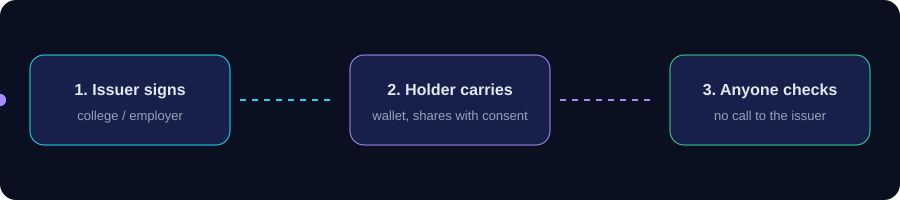

<div align="center">


[](https://sigil-three-chi.vercel.app)
[](docs/SUMMARY.md)


**[Live demo](https://sigil-three-chi.vercel.app)** · **[5-minute summary](docs/SUMMARY.md)** · **[Architecture](docs/ARCHITECTURE.md)** · **[Demo script](docs/DEMO_SCRIPT.md)**

<sub>Every page in the live demo is labelled <b>Sample data</b>.</sub>

</div>

## The idea

Checking a certificate or resume today means a phone call, an email or a trust-me PDF. Sigil replaces that with **issuer-signed proofs** that anyone can verify instantly, with no per-check lookup to the issuer.



## What it does

| | Feature | In plain words |
|---|---|---|
| 🎓 | **Certificates** | Issuer-signed, tamper-evident, checked offline-friendly |
| 📄 | **Whole resumes** | Education, jobs, certificates and skills, each claim routed to who can vouch for it |
| 🧾 | **Paper check** | Scan a printed certificate and see if it matches a signed record |
| 👛 | **Wallet** | The holder owns the proofs and approves every share with a consent receipt |
| 🏛️ | **Issuer console** | Sign, rotate keys, revoke |
| 🔎 | **Recruiter view** | One screen, one question, one big button |
| 🌐 | **Languages** | English, Hindi, Marathi |

## Principles

- **Witness rule.** Never "verified" without naming who vouched, how and when. No witness means *Not verified*, never *fake*.
- **AI proposes, the holder confirms.** AI never decides. No scoring or ranking of people.
- **Privacy by default.** The server stores no personal credential fields by default.
- **Truth over hype.** Every number is cited from `docs/research/` or measured in `bench/`.

## Run it

```bash
pnpm install
pnpm dev          # http://localhost:3000
pnpm test         # unit tests
pnpm typecheck && pnpm lint
node --test spikes/crypto-core/sigil.test.js   # crypto contract, must stay 20/20
```

## Repo map

```
apps/web         Next.js app (wallet, issuer, recruiter, /check)
packages/core    crypto and trust engine
packages/parser  resume claim extraction
spikes/          crypto-core behavioural contract
supabase/        schema and RLS
bench/           measurements behind every number
docs/            vision, UX, architecture, research
assets/          deck, speaking scripts, promo videos
```

## Docs

[Summary](docs/SUMMARY.md) · [Problems and solutions](docs/PROBLEMS_AND_SOLUTIONS.md) · [Master plan](docs/MASTER_PLAN.md) · [UX spec](docs/UX_SPEC.md) · [Architecture](docs/ARCHITECTURE.md) · [AI models](docs/AI_MODELS.md) · [Research](docs/RESEARCH.md) · [QA](docs/QA.md) · [Pitch](docs/PITCH.md) · [Decisions](docs/DECISIONS.md)

## Team

**Team Sigil, VIT Pune:** Viral Dhoka · Tanaya Thorat · Nayan Thakare · Shreenath Utekar

Source: https://github.com/viralala/sigil
